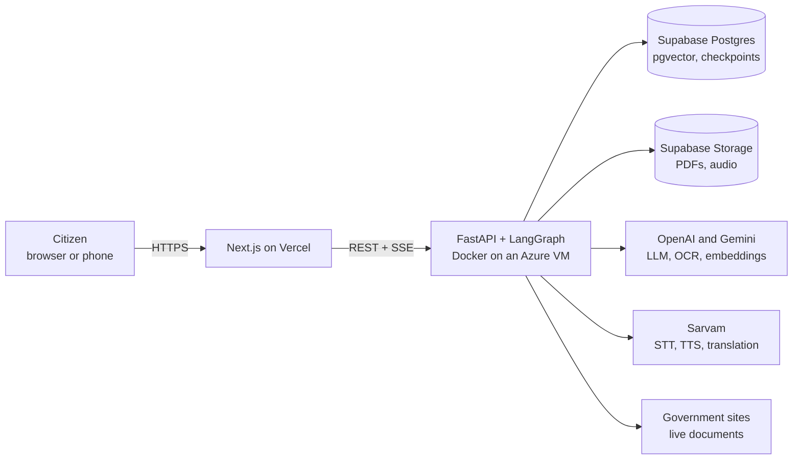
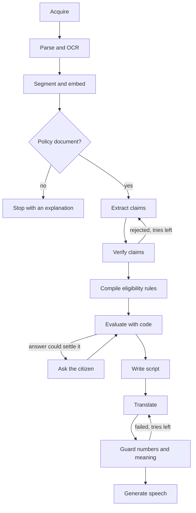

# Haq

Haq turns a real government document into a spoken explanation in a citizen's language. Every sentence links to the clause it came from, a claim is shown only after code has checked its quote and numbers against the source, and eligibility is calculated by code, not by an LLM.

**Live app:** https://hackthon-rust-gamma.vercel.app · **API health:** https://haq.southindia.cloudapp.azure.com/v1/health

## The problem

Government notifications and welfare policies decide what people can claim, but they're long, legalistic, often scanned, and often not in the reader's language. A chatbot can summarise one, but it can also invent a rule or an amount, and the reader can't tell when it has.

Haq is for citizens with low literacy or limited English, small business owners, and the field workers who explain schemes to them.

## What it does

1. **Takes a real document:** a government PDF link, an upload, or a library of documents that went through the same pipeline. Scanned Hindi PDFs and PDFs with broken text layers are read with OCR.
2. **Finds the rights in it:** benefits, eligibility, documents, deadlines and more. The live trace shows rejected claims and retries as they happen.
3. **Shows its proof:** clicking a claim highlights the clause in the original PDF.
4. **Works out eligibility:** it asks only the questions that could change the result, by form or voice, and answers "appears to meet", "doesn't meet" or "can't determine".
5. **Explains it aloud:** in Hindi or Marathi, sentence by sentence, with captions tied to the source.
6. **Answers questions, or says it can't:** a question the document doesn't answer gets "This document does not say", not a guess.

## How it stays honest

| Risk | What happens |
|---|---|
| LLM invents a fact | The quote must be in the cited clause, and every number in the claim must be in the quote. No LLM can overrule these checks. An LLM must then judge that the source supports the claim |
| LLM decides eligibility wrongly | Criteria compile to a rule tree that code evaluates. A rule that doesn't fit is marked `Unevaluable`, which leads to "can't determine" |
| Missing answer becomes a rejection | Three-valued logic: unknown stays unknown |
| Translation changes an amount | Numbers are compared in code after translation. A sentence that keeps failing gets no audio |
| Personal data leaks | Answers stay in backend memory for up to an hour, never in the database. Scripts state the criteria, never the citizen's values |

## Architecture



The agent is a LangGraph workflow. LLMs decide what a document says and how to word it. Code decides whether a citation is valid, whether numbers survived, and what the eligibility outcome is. Every loop is limited by a retry count and a per-run budget.



| Layer | Choice |
|---|---|
| Frontend | Next.js, TypeScript, Tailwind, PDF.js |
| Backend | Python 3.12, FastAPI, LangGraph, PyMuPDF, Playwright |
| Data | Supabase Postgres with pgvector, Supabase Storage |
| AI | OpenAI and Gemini with automatic failover, Sarvam for Indian-language voice and translation |
| Hosting | Vercel, Docker Compose and Caddy on an Azure VM in South India |

## Results

Measured through the live API on 3 real government PDFs. This is a small sample.

| Metric | Result |
|---|---|
| Shown claims whose quote a separate re-check found in the cited clause | 92 of 92 |
| Spoken sentences that kept their numbers | 58 of 58, with audio withheld for 5 more that failed the guard |
| Off-topic questions that got an abstention | 29 of 30. The other was a cited, correct "no" |
| Time to first audio after answers | 40 to 65 s |
| Time to rights card | 36 to 83 s. The 24-page PDF missed the 60 s target |

**Known problems, not yet fixed:**

- 2 of 3 eligibility verdicts wrongly said "doesn't meet", because a rule for one group or scheme was applied to everyone.
- 3 of 9 on-topic questions got "This document does not say" when the document does answer them.
- Precision and recall haven't been measured.

## Run it yourself

You need Docker, Node 24, a Supabase project, and API keys for Gemini, OpenAI and Sarvam. To run the backend without Docker, you also need [uv](https://docs.astral.sh/uv/).

```sh
git clone https://github.com/Deepak1230987/hackthon.git haq && cd haq
cp .env.example .env     # fill it in, see the table below
```

Create a private bucket in Supabase with the name in `STORAGE_BUCKET`. Then start the backend. Migrations don't run on their own, so run them first:

```sh
docker compose build api
docker compose run --rm api alembic upgrade head
docker compose up -d
curl http://localhost/v1/health
```

Start the frontend in a second terminal:

```sh
cd frontend
cp .env.example .env.local     # NEXT_PUBLIC_API_URL=http://localhost:8000 by default
npm ci
npm run dev
```

The default URL suits a backend run with `uv run python -m app`, as in the [backend README](backend/README.md). With Compose, the API is behind Caddy on port 80, so set `NEXT_PUBLIC_API_URL=http://localhost`.

Open http://localhost:3000. The library starts empty in a new database, so paste a PDF link or upload a file. To add a document to the library, see the [backend README](backend/README.md#add-a-document-to-the-library).

### Environment variables

The full list, with defaults and notes, is in [.env.example](.env.example).

| Variable | Needed | Purpose |
|---|---|---|
| `DATABASE_URL` | Yes | Supabase Postgres. Use the transaction pooler on port 6543 |
| `SUPABASE_URL`, `SUPABASE_SERVICE_KEY`, `STORAGE_BUCKET` | Yes | Stores PDFs and audio |
| `GEMINI_API_KEY` | Yes | Embeddings, and the fallback LLM and OCR |
| `OPENAI_API_KEY` | Yes, with the default models | Primary LLM and OCR. A model whose provider has no key is skipped |
| `SARVAM_API_KEY` | Yes | Speech to text, text to speech, translation |
| `EMBEDDING_DIM` | Yes | Must match `EMBEDDING_MODEL`. Migrations need it |
| `API_DOMAIN` | For HTTPS | A hostname gets a certificate automatically. `:80` serves plain HTTP |
| `ALLOWED_ORIGINS` | For deployment | The frontend's URLs, comma-separated, with no trailing slash |
| `LLM_*`, `OCR_*`, `TTS_*`, `TRANSLATE_MODEL`, `STT_MODEL` | No | Which models to use. The name decides the provider |
| `MAX_*`, `RUN_*`, `PROFILE_TTL_S`, `CROSS_PROVIDER_VERIFY` | No | Limits and options |
| `NEXT_PUBLIC_API_URL` | Frontend | The backend's URL, with no trailing slash. Inlined at build time |

### Tests

```sh
cd frontend && npm run lint && npm test && npm run build
cd backend && uv sync --frozen && uv run pytest
```

Backend integration tests are skipped unless `TEST_DATABASE_URL` is set, and they **wipe the database they connect to**. See the [backend README](backend/README.md#test).

## Limits

- It reads one document at a time, and can't tell whether a newer document has replaced it.
- It isn't legal advice and doesn't file applications. The app says so.
- One VM runs three documents at once, and the rest wait in a visible queue.
- Voice recordings go to Sarvam to be transcribed. The app says so, and asks people not to say names or ID numbers.
