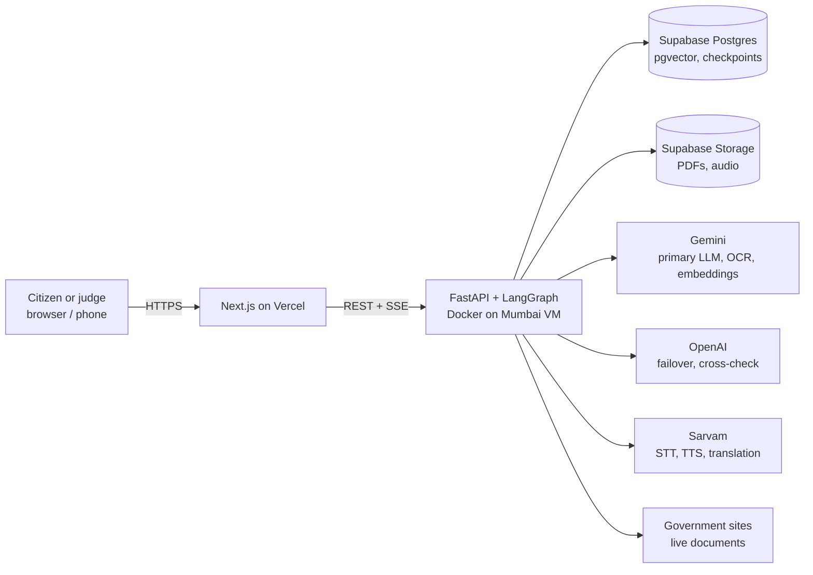
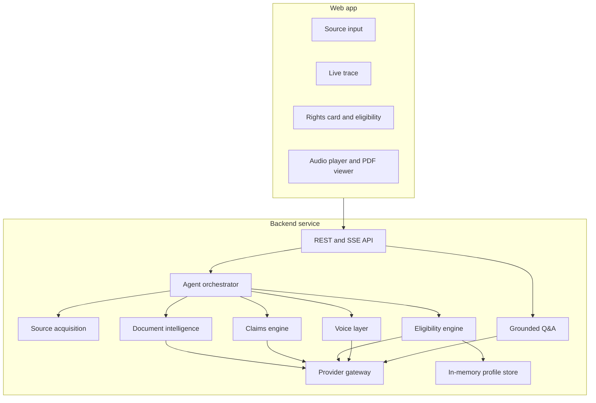
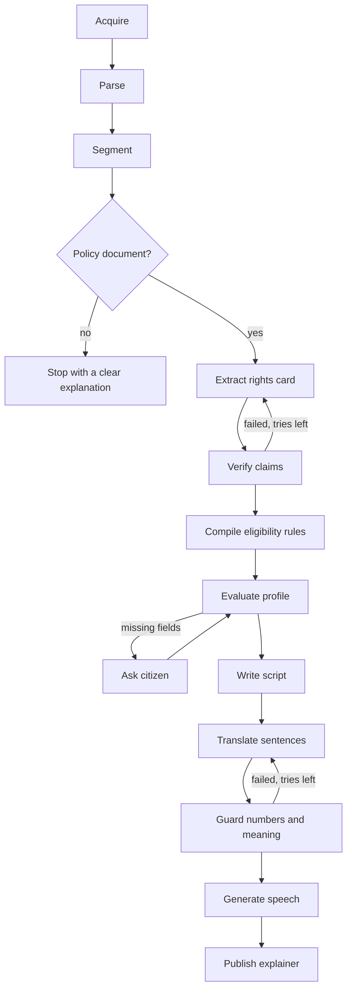
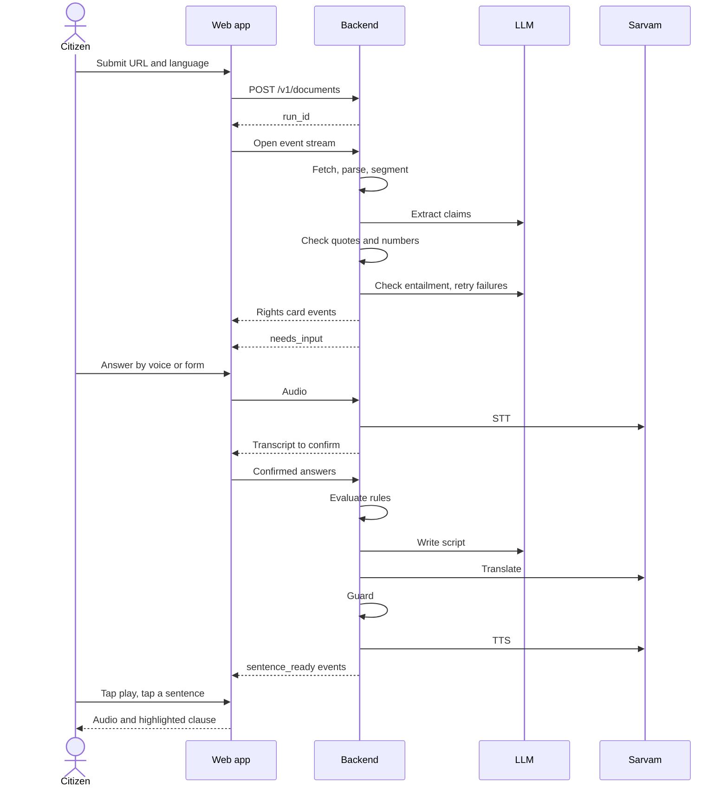
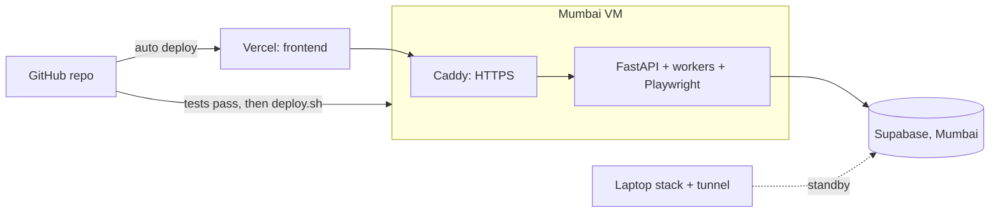

# Haq: High-Level Design

**Related documents:** [Low-level design](LLD.md) · [Implementation plan](IMPLEMENTATION_PLAN.md) · [Stress test](STRESS_TEST.md)

## 1. Purpose

### 1.1 Problem

Government notifications, welfare policies and municipal laws decide what citizens and small businesses can claim. They are usually long, legalistic, sometimes scanned, and often unavailable in the reader's language. Generic chatbots can summarise them, but they can also invent eligibility rules or amounts, and the reader cannot tell when that has happened.

### 1.2 Users

| User | Need |
|---|---|
| Citizen with low literacy or limited English | Hear what a policy means for them, in their language |
| Small business owner | Understand obligations, benefits and deadlines |
| Community or field worker | Explain a scheme reliably to many people |
| Scheme official (future) | Check how a policy is being explained |

### 1.3 Product summary

Haq takes a real government document and a citizen's situation. It produces a spoken explanation in the citizen's language, where every sentence links to the clause it came from and eligibility is calculated by code.

### 1.4 Differentiators

| Differentiator | Why it matters |
|---|---|
| Clause-level proof | Any sentence can be checked against the highlighted original |
| Code checks citations | A quote that isn't in the source is rejected, whatever the LLM claims |
| Computed eligibility | The same inputs always give the same result, and it can be tested |
| Visible abstention | It says "this document does not say" instead of filling gaps |
| Translation guard | Amounts and dates are checked after translation |

### 1.5 Goals

- Run end to end on real documents supplied during judging.
- Allow no unverified factual statement to reach the citizen.
- Degrade clearly when any external service fails.
- Show the agent's reasoning, rejections and retries live.

### 1.6 Non-goals

- Filing applications for citizens (Problem 3).
- Legal advice, or a final decision on entitlement.
- Reconciling several documents or tracking which version is current.
- Storing citizen profiles or accounts.

## 2. System context

## 3. Architecture

### 3.1 Logical components

| Component | Responsibility | Does not do |
|---|---|---|
| API | Validate requests, start runs, stream events, serve files | Business logic |
| Orchestrator | Sequence nodes, retries, pauses, checkpoints | Direct provider calls |
| Source acquisition | Fetch safely, validate files, record provenance | Interpret content |
| Document intelligence | Page text, OCR, tables, clauses, embeddings | Decide what clauses mean |
| Claims engine | Extract rights and verify each against its source | Personalise results |
| Eligibility engine | Compile rules, evaluate, choose follow-up questions | Use an LLM to decide outcomes |
| Voice layer | Script, translate, guard, TTS, STT | Add facts beyond verified claims |
| Grounded Q&A | Retrieve clauses and answer through the verifier | Answer from general knowledge |
| Provider gateway | Retries, failover, rate limits, budgets, usage records | Prompt logic |
| Profile store | Hold profile values in memory with a 1-hour expiry | Write them to disk |

### 3.2 Agent workflow

**Autonomy and control:** LLMs decide what a document says, how to word it, and how to repair a rejected output. Code decides whether a citation is valid, whether numbers survived, and what the eligibility outcome is. All loops are bounded by retry counts and a per-run budget.

### 3.3 Main sequence

## 4. Technology

| Layer | Choice | Why |
|---|---|---|
| Frontend | Next.js, TypeScript, Tailwind, PDF.js | Fast to build, and Vercel deployment is simple |
| Backend | Python, FastAPI, Pydantic | Best fit with PDF and LLM libraries |
| Orchestration | LangGraph | Loops, interrupts and checkpoints are built in, and easy to explain |
| PDF processing | PyMuPDF | Text positions and table detection |
| Browser fetch | Playwright | Reaches JavaScript-only pages |
| Database | Supabase Postgres, pgvector (Mumbai region) | One managed service for relational data, vectors and storage |
| LLM | Gemini primary, OpenAI failover | Two independent providers, both already available |
| Voice | Sarvam `saaras`, `bulbul`, `sarvam-translate`/`mayura` | Purpose-built for Indian languages |
| Hosting | Mumbai VM, Docker Compose, Caddy | No cold starts or request timeouts, and an Indian IP |

## 5. Key design decisions

| # | Decision | Rejected alternative | Reason |
|---|---|---|---|
| 1 | Always-on VM | Serverless containers | Runs last minutes, use Playwright and hold memory-only profiles |
| 2 | In-process worker | Redis and Celery | Less to break at demo scale |
| 3 | Single-document scope | Corpus-wide RAG | Precise and honest attribution in 35 hours |
| 4 | Verification before display | Display, then verify | Unverified text must never reach the citizen |
| 5 | Rule interpreter | LLM decides eligibility | Deterministic and testable |
| 6 | Per-sentence translation and audio | Whole-script processing | Exact mapping and caption sync, and it fits API limits |
| 7 | Profile in memory only | Encrypted database table | Avoids holding sensitive data at all |
| 8 | Upload and prepared library | Rely on live portals alone | Portals may block or fail during judging |

## 6. Data

### 6.1 Sources

Official PDFs fetched live from government sites, documents uploaded by users, and a prepared library of real documents fetched through the same pipeline. Library entries are database rows created by that pipeline, never seed files, to satisfy the no-dummy-data rule. Candidate sites are tested at hour 3. See the [stress test](STRESS_TEST.md#1-live-checks) for current access results.

### 6.2 Classification

| Data | Sensitivity | Storage | Retention |
|---|---|---|---|
| Public documents, clauses | Public | Postgres, object storage | Kept |
| Claims, scripts, general audio | Public-derived | Postgres, object storage | Kept |
| Profile values | **Personal** | Backend memory only | 1 hour or restart |
| Voice recordings | **Personal** | Passed to Sarvam, not stored by Haq | Not retained by Haq |
| Logs and events | Operational | Postgres, stdout | Must not contain profile values or transcripts |

Generated scripts and audio never repeat a citizen's values. They say "the income limit is ₹2.5 lakh", not "your ₹2 lakh income qualifies".

## 7. Quality attributes

| Attribute | Target | Approach |
|---|---|---|
| Accuracy | 100% valid citations, zero invented facts in demo documents | Layered verifier |
| Availability during judging | No crash in the full failure matrix | Failover and degraded modes |
| Time to first rights card | Under 60 seconds for a 30-page digital PDF | Parallel verification, live progress |
| Time to first audio | Under 2 minutes after answers are complete | Audio generated sentence by sentence |
| Concurrency | 3 active runs, others queued | Semaphore and shared rate limiter |
| Recovery | Resume a run after a backend restart | Postgres checkpoints; profile answers are asked again |

These are targets to measure in phase 6, not results.

## 8. Failure and degraded modes

| Failure | Citizen sees |
|---|---|
| Source site blocks or fails | A clear message and a choice to upload or use the library |
| Gemini unavailable | Normal service via OpenAI; failover shown in the trace |
| Both LLMs unavailable | Already verified results stay visible, with a request to retry |
| Sarvam TTS unavailable | Text explanation and captions without audio |
| Sarvam translation unavailable | LLM translation, labelled and still guarded |
| Sarvam STT or mic unavailable | Typed answers |
| Numeric guard keeps failing | The sentence is flagged and its audio is withheld |
| Run budget exhausted | Partial result, labelled as partial |

## 9. Security and responsible AI

- **Untrusted input:** URLs pass an SSRF guard. PDFs are checked for type and size. Document text is treated as data, and extraction nodes have no tools.
- **Secrets:** environment variables only, with `.env` ignored by git and `.env.example` committed.
- **Abuse limits:** per-IP run limits, file limits and per-run budgets.
- **Honest output:** "appears to meet" wording, the document's issue date, an old-document warning, a not-legal-advice notice and a link to the official source.
- **Disclosure:** voice is processed by Sarvam, and the UI asks people not to say names or ID numbers.

## 10. Deployment

The laptop standby uses the same Compose file and database. Switching to it requires changing the frontend's API URL environment variable and redeploying on Vercel, so rehearse this before judging.

## 11. Scalability path

Not built during the hackathon:

| Stage | Change |
|---|---|
| More traffic | Move work to a queue with separate workers |
| More content | Monitor official sources and detect new versions |
| More reach | WhatsApp and IVR channels, more languages |
| Better answers | Multi-document retrieval with superseded-version tracking |
| Institutional use | Review and correction tools for departments and NGOs |
