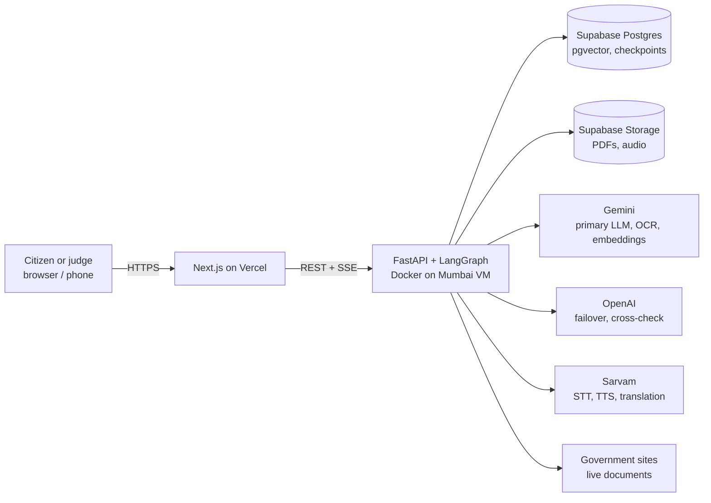
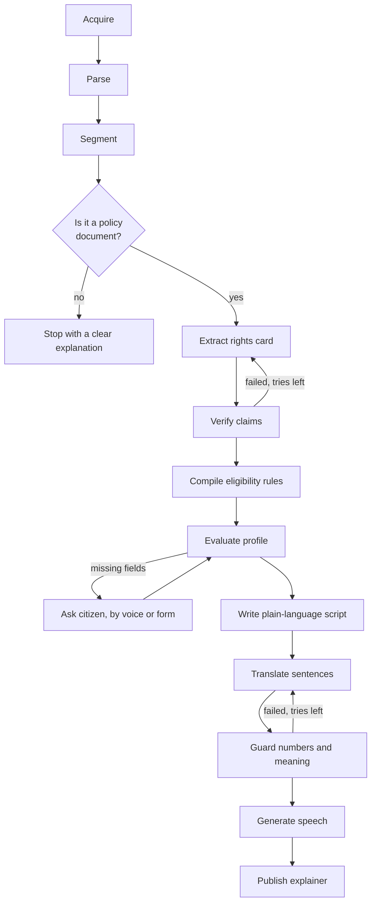

# Haq: architecture and implementation plan

**Track:** Problem 1, Multilingual Policy, Rights & Scheme Explainer. "Haq" is a working name.
**Constraints:** 35 hours, 1-2 people. Gemini and OpenAI for LLMs, Sarvam for voice. Demo languages are Hindi plus Bengali or Marathi, whichever a team member can verify.

**In one line:** give it a real government document and a citizen's situation. It returns a spoken explanation in their language where every sentence links to the clause it came from, and eligibility is calculated by code rather than guessed by an LLM.

---

## 1. High-level design

### 1.1 System context



### 1.2 Key decisions

| Decision | Choice | Reason |
|---|---|---|
| Hosting | One always-on VM in Mumbai with Docker Compose and Caddy | No cold starts, no request timeouts, room for Playwright, and an Indian IP for government sites |
| Job execution | In-process async worker, max 3 concurrent runs, extra runs queue | A separate queue adds failure points without helping at demo scale |
| Orchestration | LangGraph with a Postgres checkpointer | Retry loops and resume after a crash are visible and explainable |
| Live progress | SSE with stored events and a polling fallback | Survives reconnects and flaky venue networks |
| Translation unit | One sentence at a time | Keeps each sentence tied to its clause, and fits Sarvam's limits |
| Audio unit | One clip per sentence, played in sequence | Exact caption and clause sync without any timing alignment |
| Eligibility | Closed-grammar rules run by a Python interpreter | Deterministic and testable, and it can say "unknown" |

### 1.3 Pipeline



Failed claims are never passed on. Once retries run out, a claim becomes "this document does not say".

### 1.4 Components

| Component | Job |
|---|---|
| Source acquisition | Get the document and record its provenance |
| Document intelligence | Turn the PDF into clauses with positions, using OCR when needed |
| Claims engine | Extract and verify the rights card |
| Eligibility engine | Compile and evaluate rules, and generate follow-up questions |
| Voice layer | Translate, guard, and handle TTS and STT |
| Q&A | Answer follow-ups from clauses, through the same verifier |
| Provider gateway | Handle retries, failover, rate limits and per-run budgets |
| Web app | Source input, live trace, rights card, eligibility, audio, PDF viewer |

---

## 2. Low-level design

### 2.1 Repository layout

```
backend/app/
  main.py            api/{documents,runs,sessions,qa,health}.py
  graph/             state.py  build.py  nodes/{acquire,parse,segment,triage,extract,
                     verify,compile_rules,evaluate,script,translate,guard,tts}.py
  eligibility/       ast.py  interpreter.py
  providers/         gateway.py  gemini.py  openai.py  sarvam.py  ratelimit.py
  acquisition/       fetchers.py  ssrf.py
  db/                models.py  migrations/
  prompts/           *.md
backend/tests/       unit/  fixtures/  eval/
frontend/            app/  components/{SourceInput,AgentTrace,RightsCard,
                     EligibilityPanel,AudioPlayer,PdfViewer}
docker-compose.yml   Caddyfile   .env.example   README.md
```

### 2.2 Data model (Postgres)

| Table | Key columns |
|---|---|
| `documents` | `id`, `source_url`, `sha256` (unique), `storage_path`, `fetched_at`, `fetch_method`, `issue_date`, `page_count`, `is_scanned`, `title`, `issuing_authority` |
| `clauses` | `id`, `document_id`, `ordinal`, `page`, `bbox` (nullable), `text`, `norm_text`, `lang`, `kind` (`para`, `table_row`, `heading`), `extraction` (`native`, `ocr`), `embedding vector` |
| `runs` | `id`, `document_id`, `status`, `language`, `llm_calls`, `cost_estimate`, `started_at`, `finished_at`, `error_code` |
| `run_events` | `run_id`, `seq`, `type`, `payload`, `created_at` (primary key `run_id, seq`) |
| `claims` | `id`, `run_id`, `field`, `text`, `clause_ids[]`, `quote`, `status` (`verified`, `not_stated`), `failure_reason`, `attempts` |
| `rules` | `id`, `run_id`, `claim_id`, `ast jsonb`, `fields_required[]` |
| `sentences` | `id`, `run_id`, `ordinal`, `language`, `source_text`, `translated_text`, `claim_ids[]`, `audio_path`, `guard_status` |

Citizen profiles are **not** stored in these tables. They stay in graph state for the session and are deleted after 1 hour, and are never logged.

### 2.3 Graph state and node contracts

```python
class RunState(TypedDict):
    run_id: str; document_id: str; language: str
    profile: dict[str, Any]         # session only
    clauses: list[ClauseRef]
    claims: list[Claim]
    rules: list[Rule]
    verdict: Verdict | None
    script: list[ScriptSentence]
    attempts: dict[str, int]        # capped per claim and sentence
    budget: Budget                  # max 60 LLM calls, 180s, excluding human waits
```

| Node | Input to output | Failure behaviour |
|---|---|---|
| `acquire` | URL or file to `document` | Moves through fetch tiers, then asks for an upload |
| `parse` | PDF to page text | Sends garbled or empty pages to OCR |
| `segment` | Pages to clauses and embeddings | Over 200 pages: asks the citizen to pick a page range |
| `triage` | Clause sample to `is_policy`, type | Not a policy: stops and explains |
| `extract` | Clauses to candidate claims | Schema failure: one repair attempt, then failover |
| `verify` | Claims to verified claims | Retries that claim only, max 2, then `not_stated` |
| `compile_rules` | Eligibility claims to AST | Unrepresentable: `unevaluable` with the original text |
| `evaluate` | AST and profile to verdict | Missing data: `interrupt()` to ask the citizen |
| `script` | Verified claims and verdict to sentences | Any sentence without a claim ID is dropped |
| `translate` | Sentences to target language | Sarvam, then LLM fallback, labelled in the trace |
| `guard` | Source and translated sentence to pass or fail | Retries, max 2, then shows a flagged sentence and skips its audio |
| `tts` | Sentences to audio clips | Text captions remain usable if TTS is down |

### 2.4 Parsing and clause segmentation

1. Extract text and block positions with PyMuPDF.
2. Score each page for garbling: too few characters, a high replacement-character ratio, or Latin text with mojibake patterns. Legacy Hindi fonts such as Kruti Dev extract as readable-looking nonsense, so this check is essential.
3. Send failed pages as images to Gemini for OCR. These clauses have `extraction=ocr` and `bbox=null`, so the viewer highlights the page and shows the quote.
4. Detect tables with PyMuPDF `find_tables()` and store each row with its header as one clause, because eligibility often sits in tables.
5. Detect language per clause. Bilingual PDFs keep both versions, and extraction prefers one version to avoid duplicate claims.
6. Build `norm_text`: Unicode NFC, unified digits, collapsed whitespace.

### 2.5 Claim verification

```python
def verify(claim, clauses) -> Result:
    # 1. Structural: cited clause must exist
    # 2. Quote: normalised quote must appear in the cited clause
    #    native text: exact match; OCR text: rapidfuzz partial_ratio >= 92
    # 3. Numeric: every number and date in claim.text must appear in the quote
    # 4. Semantic: LLM entailment gives ENTAILED / NOT_ENTAILED / PARTIAL
    #    (optionally on the other provider; see the cut list)
    # Steps 1-3 run first because they are free and deterministic.
```

Only `ENTAILED` passes. The failure reason goes into the retry prompt, which is what produces a visible self-correction in the trace.

**Prompt injection:** document text is wrapped as untrusted data, and extraction nodes have no tools and must return a fixed schema. An injected instruction can therefore only produce a claim, and that claim must still pass verification.

### 2.6 Eligibility engine

```python
Expr = And(items) | Or(items) | Not(item)
     | Cmp(field, op, value)      # op in: eq ne lt lte gt gte in not_in
     | Unevaluable(source_text)
```

- **Three-valued logic:** each expression returns `True`, `False` or `Unknown`, so missing data can't become a false "not eligible".
- **Fields:** a fixed registry (`age`, `gender`, `state`, `annual_income_inr`, `occupation`, `social_category`, `land_holding_hectares`, `business_turnover_inr`, `is_bpl`, and similar) plus document-specific fields, each with a generated question.
- **Safety:** the AST is validated by Pydantic and walked by an interpreter. It is never passed to `eval`.
- **Follow-ups:** ask next for the field that could settle the most undecided criteria.

| Verdict | Worded as |
|---|---|
| `MEETS_STATED_CRITERIA` | "You appear to meet the criteria in this document" (never "you are eligible") |
| `DOES_NOT_MEET` | Names the exact failed criterion and links its clause |
| `NEEDS_INFO` | Asks the next question |
| `CANNOT_DETERMINE` | Lists what needs a human decision, and which authority to ask |

### 2.7 Voice layer

| Step | Setting | Detail |
|---|---|---|
| Translation | `sarvam-translate:v1` or `mayura:v1`, `numerals_format=international` | 2,000 and 1,000 character limits. Digits stay in 0-9, which makes the guard simple |
| Numeric guard | Deterministic | Normalise numbers, including lakh and crore, then compare the sets between source and translation |
| Meaning guard | LLM back-translation | Runs after the numeric guard passes |
| TTS | `bulbul:v4-flash` unless v3 is clearly better in the hour-0 listening test | 2,500 character limit. Clips stored as MP3 and cached by hash of text, language and voice |
| STT | `saaras:v4`, `language_code=unknown` | Sync API is for clips under 30 seconds, so the UI stops recording at 25 seconds |
| Rate limiting | Shared token bucket, 1 request/second per API | Pay-as-you-go limit is 60/min per account |

Before the first clip plays, Haq needs a tap from the user, because mobile browsers block autoplay. Mic denied or unavailable falls back to a typed answer.

### 2.8 API

| Method and path | Purpose |
|---|---|
| `POST /v1/documents` | Register a URL or upload, returns a document and run |
| `GET /v1/documents/{id}/file` | Serve the PDF to the viewer, avoiding CORS issues |
| `GET /v1/runs/{id}/events` | SSE stream, supports `Last-Event-ID` |
| `GET /v1/runs/{id}` | Full state, also the polling fallback |
| `POST /v1/runs/{id}/answers` | Provide profile values, resumes the graph |
| `POST /v1/runs/{id}/stt` | Audio in, transcript and confidence out |
| `POST /v1/runs/{id}/qa` | Grounded follow-up question |
| `GET /v1/health` | Database and provider status for the pre-demo check |

SSE events are `node_started`, `node_finished`, `claim_verified`, `claim_rejected`, `retry`, `failover`, `needs_input`, `sentence_ready`, `run_finished` and `run_failed`, with a heartbeat every 15 seconds.

### 2.9 Source acquisition

```
Tier 1  httpx with a normal browser user agent and a complete CA bundle
Tier 2  Playwright, for JavaScript pages and sites rejecting plain clients
Tier 3  Ask the user to upload the file
```

- **SSRF guard:** allow only `http(s)`, resolve the host and block private, loopback and metadata addresses, and re-check on each redirect. Limits are 50 MB and a 45-second timeout, and the content must be a real PDF.
- **Provenance:** store the URL, method, timestamp and SHA-256, and show them in the UI. An unverified upload is labelled "uploaded by user".
- **Prepared library:** at hour 2, fetch 5-8 official documents from their original sources through this same pipeline. If a portal is down during judging, these remain real documents, labelled with their fetch time.

### 2.10 Provider gateway and errors

| Error | Action |
|---|---|
| 429, 503, timeout | Exponential backoff with jitter, max 3 tries, then failover |
| Invalid structured output | One repair attempt, then the other provider |
| Sarvam 402 (credits gone) | No retry. Alert in logs and health check, and fall back to text captions |
| Budget exhausted | Finish with what is verified and say the result is partial |
| Worker crash | Resume from the Postgres checkpoint at startup |

Model names come from environment variables and are fixed at hour 0. Google's docs currently show `gemini-3.8-flash` in their examples, so confirm against the live model list rather than hardcoding from memory.

### 2.11 Frontend

| Screen | Details |
|---|---|
| Start | Paste a URL, upload, or pick from the prepared library, then choose a language |
| Live trace | Each node's status, including rejected claims and retries |
| Rights card | Benefits, eligibility, documents, deadlines and authority, each with a source link |
| Eligibility | Voice or form questions, and the verdict with per-criterion results |
| Listen | Sentence-by-sentence player with captions and an English toggle |
| Source viewer | PDF.js with the clause highlighted, or a page-level highlight for OCR |

Every state has a designed empty, loading and error view. An old `issue_date` shows "check this is the latest version".

---

## 3. Phased implementation

Each phase ends at a gate. **If a gate is missed, use the cut list rather than borrowing from the next phase's time.**

| Phase | Hours | Build | Gate |
|---|---|---|---|
| **0. Spikes** | 0-3 | Public repo, confirm rules with organisers, keys, Mumbai VM, Supabase. Test every provider once and fetch real documents from the VM. Listen to TTS samples | **Go/no-go list in section 3.1 passes** |
| **1. Skeleton** | 3-6 | FastAPI, schema, LangGraph with stub nodes, SSE, Next.js trace screen, deployed on day one | Public URL shows a live trace from a real uploaded PDF |
| **2. Documents** | 6-10 | Acquisition tiers, SSRF guard, parsing, garble detection, OCR, tables, segmentation, embeddings, build the prepared library | A digital PDF and a scanned Hindi PDF both produce correct clauses |
| **3. Claims** | 10-15 | Extract, verify, retry, gateway and failover, rights card with PDF highlight | Rights card with working citations, and one visible self-correction |
| Sleep | 15-19 | Alternate if two people | |
| **4. Eligibility and voice** | 19-24 | AST, interpreter with unit tests, follow-ups, script, translation, guards, TTS, STT | **Full Hindi flow works on the public URL. This is the most important gate** |
| **5. Finish** | 24-28 | Second language, voice Q&A, UI polish, error states | A stranger uses it without help |
| **6. Harden** | 28-30 | **Feature freeze.** Failure matrix in section 4.3, evaluation run, fixes only | Matrix passes, and real accuracy numbers exist |
| Sleep | 30-32 | | |
| **7. Ship** | 32-35 | README and diagram, 6-slide deck, video on the live system, rehearsal. **Submit by hour 34** | All links work in incognito |

### 3.1 Hour-3 go/no-go list

| Check | If it fails |
|---|---|
| The Mumbai VM can fetch at least 3 official PDFs | Try Playwright, then fetch from a home connection and upload. The app still works, with honest "uploaded" labelling |
| Gemini handles a real Hindi scanned page | Use OpenAI vision for OCR |
| Sarvam's Hindi speech is understandable for a sentence with money and dates | Try the other Bulbul model, then write amounts out in words before TTS |
| Organisers allow AI coding tools and these APIs | Follow their ruling before writing any more code |
| Sarvam credits are topped up (about ₹500) and Gemini billing is on | Rate limits and test runs will otherwise stop you mid-build |

### 3.2 Work split

| | Person A | Person B |
|---|---|---|
| Owns | Graph, acquisition, parsing, claims, eligibility, evaluation | Voice, frontend, deployment, deck, video |
| Handover | Walk through each other's code at hours 24 and 32, because every member must explain the whole system | |

**Working solo:** follow the same order, and start the cut list at hour 15 instead of waiting until you are behind.

### 3.3 Cut list, in order

1. Cross-provider verification (same provider instead)
2. Voice Q&A (typed Q&A, then none)
3. Second language
4. Table-specific parsing
5. Playwright tier (upload replaces it)

**Never cut:** citations, deterministic verification checks, eligibility interpreter, Hindi voice output, failure handling, deployment.

**Stretch, only with all gates met at hour 28:** "what changed for me" comparison between two versions of a policy.

---

## 4. Stress test

### 4.1 What the live checks found

These were run on 30 October 2026 using a server-side web fetcher, not a browser and probably not from an Indian IP. Treat site results as warning signs that need re-testing from the Mumbai VM.

| Check | Result | Effect on the plan |
|---|---|---|
| myScheme scheme page | Returned an error page with no scheme content | **Removed as a main source.** Playwright may still reach it |
| eGazette | TLS certificate verification failed | Needs a complete CA bundle. Do not disable verification globally |
| PIB RSS page | HTTP 403 | Fetch tiers needed. Not relied on |
| india.gov.in guidelines listing | HTTP 403 | Same |
| Ministry of Education PM POSHAN page | HTTP 404 | Links go stale, so the library is chosen and tested at hour 2 |
| Sarvam TTS | 2,500 characters per request; Hindi, Bengali, Marathi supported | Fits per-sentence design |
| Sarvam STT | Sync API intended for under 30 seconds | Recording capped at 25 seconds |
| Sarvam translation | 1,000 or 2,000 character limit; `numerals_format` available | Enables the numeric guard |
| Sarvam limits | 60 requests/min per API; 402 when credits run out | Shared limiter and explicit 402 handling added |
| Sarvam pricing | ₹100 free credit; TTS ₹1-3, translation ₹2 per 1,000 characters; STT ₹0.49/min | See the cost estimate below |
| Gemini PDFs | 50 MB and 1,000 pages | No blocker |
| Gemini quotas | Not published by model; shown in AI Studio | Enable billing and check at hour 0 |

**Main finding:** all five government pages tested failed from this fetcher. **This is the plan's largest external risk**, and it is why the Mumbai VM, fetch tiers, prepared library and upload path all exist.

**Sarvam cost estimate:** a 1,500-character explainer costs about ₹3 to translate and ₹1.50 to speak with v4-flash, or ₹4.50 per language. The free ₹100 covers roughly 20 runs before testing and retries, which is too few, hence the ₹500 top-up. Audio caching limits repeat costs.

### 4.2 Design review

| # | Attack on the design | Severity | Resolution |
|---|---|---|---|
| 1 | Government sites block us during live judging | Critical | Fetch tiers, prepared library with real provenance, upload path |
| 2 | Hindi PDFs extract as garbage because of legacy fonts, and quotes then "verify" against garbage | Critical | Garble detection routes those pages to OCR |
| 3 | Verifier passes a real quote that doesn't support the claim | High | Numeric check plus entailment; only `ENTAILED` passes |
| 4 | LLM wrongly rejects correct claims and the card ends up empty | High | Measured in evaluation. Show "not stated" honestly, and tune the prompts against labelled documents |
| 5 | OCR errors break exact quote matching | High | Fuzzy threshold for OCR clauses only, labelled in the UI |
| 6 | Real criteria don't fit the rule grammar ("as decided by the district officer") | High | `Unevaluable` leads to `CANNOT_DETERMINE`, never a guess |
| 7 | Missing profile data becomes a false rejection | High | Three-valued logic |
| 8 | Document is outdated or superseded | High | Show issue date and a warning. Single-document scope is stated openly |
| 9 | Translation changes ₹2.5 lakh or a deadline | High | Numeric guard, then a flag and no audio if it still fails |
| 10 | Translation is correct but too formal for ordinary citizens | Medium | Simplify in English first, then test `modern-colloquial` in `mayura:v1` |
| 11 | Long PDF exhausts budget or time | High | Page limit, range selection, per-run budget, partial results labelled |
| 12 | A judge pastes a non-government or hostile URL | High | SSRF guard, PDF validation, triage stop |
| 13 | Prompt injection inside a PDF | Medium | Data wrapping, no tools, fixed schema, verification |
| 14 | Several judges at once hit rate limits | Medium | 3 concurrent runs, queue with position shown, shared limiter |
| 15 | Network drops during the demo | Medium | SSE resume, polling, resumable server-side runs, phone hotspot |
| 16 | The VM dies | Medium | Docker Compose rebuilds it quickly. Keep a laptop stack and tunnel ready as a standby |
| 17 | Scanned pages have no clause coordinates | Medium | Page-level highlight with quote, explained in the UI |
| 18 | Citizen's personal data leaks | High | Session-only profile, no logging. Voice still goes to Sarvam, so disclose it and ask for no names or ID numbers |
| 19 | Judge says "this is dummy data" | Critical | No seeded app data, visible provenance, live pick by the judge. Labelled evaluation data stays in `tests/` |
| 20 | Judge says "this is a pre-existing project" | Critical | Empty repo at hour 0, frequent commits |
| 21 | One member can't explain part of the code | Critical | Handovers at hours 24 and 32, and mock questions in rehearsal |
| 22 | Plan is too big for 1-2 people | **Critical** | Gates, cut list, deployment from hour 6, and a working Hindi flow by hour 24 |
| 23 | Looks like a generic "chat with PDF" | High | Demo opens with the visible rejection and retry, clause links and an abstention |
| 24 | Giving wrong advice harms a real citizen | High | "Appears to meet" wording, links to the official source, and a not-legal-advice notice |

**Still open:** items 4 and 10 can only be measured on the real system, and item 1 can only be settled from the VM. All three have a set time: hour 3 for sites, and hour 28 for quality.

### 4.3 Failure matrix (phase 6)

Each case must finish with a clear message and no crash.

| Area | Cases |
|---|---|
| Input | Dead URL, HTML page, non-PDF renamed `.pdf`, encrypted PDF, 60 MB file, 300-page PDF, blank PDF, private IP URL, repeated submit |
| Content | Non-policy PDF, scanned Hindi, legacy-font Hindi, bilingual, table-only eligibility, injected instructions |
| Reasoning | Question not answered by the document, incomplete profile, contradictory answers, impossible values such as age 300 |
| Voice | Mic denied, silence, noise, 25-second cutoff, wrong language spoken, iPhone Safari recording |
| Providers | Invalid Gemini key, invalid OpenAI key, invalid Sarvam key, simulated 429, simulated 402 |
| Infrastructure | Backend restart during a run, browser refresh during a run, 3G throttling, 5 runs at once |

### 4.4 Evaluation

Hand-label 3-4 real documents, kept under `backend/tests/eval/`. Report these in the deck, using whatever the numbers turn out to be:

- Share of claims with valid citations
- Precision and recall of extracted facts
- Eligibility accuracy over about 20 written test profiles
- Correct abstention on about 10 questions the documents don't answer
- Numeric preservation across translation
- Median time to the first rights card and first audio

**Targets:** 100% valid citations, 100% numeric preservation, zero invented facts in the demo documents, and first audio under 2 minutes.

---

## 5. Submission

| Item | Plan |
|---|---|
| **Prototype** | Public URL, checked with `/v1/health` 15 minutes before judging |
| **Video (2-3 min)** | Real capture of the live system: live fetch, trace with a self-correction, rights card, voice eligibility, Hindi audio with highlighting, then an abstention |
| **Repo** | Setup steps, `.env.example`, mermaid diagrams from this document, evaluation results, all source |
| **Deck (6 slides)** | Title and team; problem; solution and features; architecture and innovation; evaluation results; roadmap and demo summary |
| **Live demo** | Open with a prepared document for a safe first run, then invite a judge to choose a real government PDF |

## 6. Verdict

**Go, on Problem 1.** No stress-test finding breaks the design, but several changed it: the hosting moved to Mumbai, myScheme is no longer a main source, the fetch tiers and prepared library were added, and legacy-font detection became essential.

The remaining risk is the build time. The hour-24 gate is the real test: a complete Hindi flow on the public URL matters more than any later feature.
